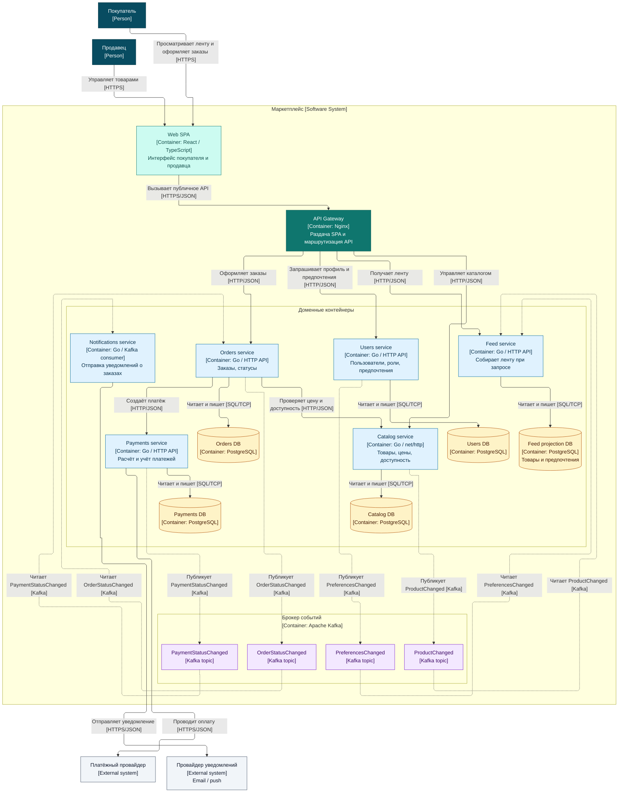

# Marketplace: OpenAPI, PostgreSQL и бизнес-операции

Go-приложение catalog-service предоставляет каталог товаров, заказы, промокоды и JWT-авторизацию с ролями.
[Технические решения](docs/hw2-design.md) описывают транзакции, деньги и правила применения промокодов.
Ниже приведена C4-диаграмма целевой сервисной архитектуры.

## Запуск и проверки

Нужны Docker Compose и доступный Docker context. По умолчанию используется профиль Colima distsys;
при первом запуске команда спросит разрешение создать или запустить его.

```bash
make up                 # PostgreSQL → Flyway → приложение; ждёт готовности
curl -i http://127.0.0.1:8080/health
make check              # Go 1.26 и Python 3: генерация, тесты, race detector, go vet
make e2e                # Python 3, стандартная библиотека: HTTP + проверки SQL
make generate           # только генерация из OpenAPI
make build              # генерация и сборка catalog-service/catalog
make db                 # интерактивный psql
make logs               # JSON-логи приложения
make down               # остановка; данные в named volume сохраняются
```

Для другого контекста передавайте его каждой Docker-команде, например `make DOCKER_CONTEXT=desktop-linux up`.
Откройте [http://127.0.0.1:8080/](http://127.0.0.1:8080/): стартовая страница содержит ссылку на проверку
доступности, Swagger UI и скачивание OpenAPI. Для запросов к защищённому API сначала зарегистрируйтесь и получите токен,
как в примере ниже. Порт можно изменить через PORT.
PostgreSQL 17 хранит данные в named volume; штатная остановка их не удаляет.
Flyway 11 применяет миграции перед запуском приложения. На Apple Silicon только контейнер миграций
использует linux/amd64 и эмуляцию. Исходники и миграции копируются при сборке образов:
запуск не зависит от того, смонтирован ли каталог репозитория в Colima.

Для запуска .env не нужен: значения по умолчанию уже заданы в compose.yaml.
[.env.example](.env.example) перечисляет настройки; скопируйте его в .env только для их изменения.
Учебная учётная запись администратора: admin@example.test / admin-local-password.
Администратор создаётся при старте приложения; публичная регистрация разрешает только USER и SELLER.
Если ADMIN_EMAIL уже занят, роль и пароль должны совпадать с существующей учётной записью администратора.
Иначе приложение остановится с сообщением об ошибке; изменение .env само по себе не меняет пароль в БД.
Пароли и JWT secret из примера предназначены для локальной работы.
ORDER_COOLDOWN_MINUTES задаёт паузу между успешными операциями пользователя одного типа, по умолчанию 1 минута.
Access token действует 20 минут, refresh token — 14 дней.

E2E создаёт данные с отдельным суффиксом запуска и сохраняет их для просмотра через SQL. Повторный запуск использует
новые учётные записи и товары. HTTP-проверки дополняются проверками остатков, заказов и промокодов в БД.
Команда сама не поднимает окружение: сначала выполните `make up`.
E2E берёт порт, учётные данные администратора и интервал операций из текущей конфигурации Compose.

## Контракт и API

Спецификация: [openapi.yaml](catalog-service/internal/api/openapi.yaml); запущенное приложение отдаёт её
по [GET /openapi.yaml](http://127.0.0.1:8080/openapi.yaml) без токена.
Модели и HTTP-интерфейс генерируются oapi-codegen v2.8.0; generated-файл исключён из Git и создаётся перед сборкой.
Ручные обработчики реализуют сгенерированный интерфейс, входные запросы проверяются по OpenAPI до бизнес-логики.
Денежные значения передаются JSON-числами и считаются через decimal; PostgreSQL хранит их как NUMERIC(12,2).
Все идентификаторы — BIGINT. Остаток в ответе может превышать диапазон INTEGER после возврата резерва;
входной остаток товара ограничен 2147483647.

| Метод и путь | Назначение и доступ |
|---|---|
| POST /auth/register | Регистрация USER или SELLER без токена |
| POST /auth/login | Access и refresh token без токена |
| POST /auth/refresh | Новая пара токенов по refresh token |
| POST /products | SELLER создаёт свой товар, ADMIN — любой |
| GET /products | Все роли; page от 0, size по умолчанию 20, максимум 100; status и category |
| GET /products/{id} | Все роли |
| PUT /products/{id} | Полная замена полей; продавец-владелец или ADMIN |
| DELETE /products/{id} | Перевод в ARCHIVED; продавец-владелец или ADMIN |
| POST /orders | USER или ADMIN |
| GET /orders/{id} | USER читает свой заказ, ADMIN — любой |
| PUT /orders/{id} | USER обновляет свой заказ, ADMIN — любой; только CREATED |
| POST /orders/{id}/cancel | USER отменяет свой заказ, ADMIN — любой; CREATED или PAYMENT_PENDING |
| POST /orders/{id}/status | Только ADMIN; переход по цепочке состояний |
| POST /promo-codes | SELLER или ADMIN |

Каталог, заказы и промокоды требуют заголовок Authorization с Bearer access token.
Стартовая страница, Swagger UI на /swagger/, GET /health, GET /openapi.yaml и методы /auth/* доступны без access token.
Неизвестный путь возвращает 404; неподдерживаемый метод известного пути — 405 с заголовком Allow.
Запрос к защищённому API без токена возвращает 401.
Ошибки имеют поля error_code, message и необязательный details; каталог кодов и HTTP-статусы описаны в контракте.
При валидации details содержит поля и нарушения. Каждый запрос получает X-Request-Id и JSON-лог с длительностью,
статусом и пользователем. Для изменяющих запросов логируется тело с маскированием паролей и токенов.

Создание заказа проверяет частоту операций, активный заказ, наличие товаров и остатки; резерв, снимок цен,
применение промокода и запись операции выполняются в одной транзакции. Повтор одного product_id в items запрещён.
При обновлении старый резерв возвращается и новый создаётся в той же транзакции; цена фиксируется заново.
Собственное использование промокода сохраняется при обновлении и не занимает вторую квоту.
Если новая сумма ниже порога промокода, скидка снимается и использование возвращается.
Отмена возвращает остатки и использование промокода.

Администратор переводит заказ по цепочке CREATED → PAYMENT_PENDING → PAID → SHIPPED → COMPLETED.
Отмена возможна из CREATED и PAYMENT_PENDING. Остальные переходы возвращают INVALID_STATE_TRANSITION.
Для процентного промокода значение выше 70 буквально трактуется по заданию: скидка не применяется,
покупатель платит полную стоимость. Фиксированная скидка не превышает сумму заказа.

## Запросы из браузера

1. Откройте [Swagger UI](http://127.0.0.1:8080/swagger/). В POST /auth/register нажмите Try it out,
   выберите USER или SELLER, задайте email и пароль, затем нажмите Execute. Для существующего пользователя
   регистрация не нужна.
2. Выполните POST /auth/login через Try it out → Execute с теми же email и паролем.
3. Скопируйте access_token из ответа, нажмите Authorize и вставьте токен без префикса Bearer.
   Refresh token используется только в POST /auth/refresh. После обновления вставьте новый access token в Authorize.
4. Откройте защищённый метод, например GET /products, и нажмите Try it out → Execute.
   SELLER может создать товар через POST /products; для заказа войдите как USER или ADMIN.

Токен авторизации не сохраняется после перезагрузки страницы. Примеры тел запросов можно редактировать;
в заказе замените product_id на идентификатор существующего активного товара.

## Пример: продавец → товар → покупатель → заказ

Команды используют curl и Python 3 для чтения JSON. Суффикс запуска позволяет повторять пример.

```bash
BASE=http://127.0.0.1:8080
RUN=$(python3 -c 'import uuid; print(uuid.uuid4().hex[:10])')
PASSWORD=Example-password-123
json_field() { python3 -c 'import json,sys; print(json.load(sys.stdin)[sys.argv[1]])' "$1"; }

curl --fail-with-body -sS "$BASE/auth/register" -H 'Content-Type: application/json' \
  -d "{\"email\":\"seller-$RUN@example.test\",\"password\":\"$PASSWORD\",\"role\":\"SELLER\"}"
SELLER_TOKEN=$(curl --fail-with-body -sS "$BASE/auth/login" -H 'Content-Type: application/json' \
  -d "{\"email\":\"seller-$RUN@example.test\",\"password\":\"$PASSWORD\"}" | json_field access_token)

PRODUCT_ID=$(curl --fail-with-body -sS "$BASE/products" \
  -H "Authorization: Bearer $SELLER_TOKEN" -H 'Content-Type: application/json' \
  -d '{"name":"Учебный товар","description":null,"price":199.99,"stock":10,"category":"demo","status":"ACTIVE"}' \
  | json_field id)

curl --fail-with-body -sS "$BASE/auth/register" -H 'Content-Type: application/json' \
  -d "{\"email\":\"buyer-$RUN@example.test\",\"password\":\"$PASSWORD\",\"role\":\"USER\"}"
USER_TOKEN=$(curl --fail-with-body -sS "$BASE/auth/login" -H 'Content-Type: application/json' \
  -d "{\"email\":\"buyer-$RUN@example.test\",\"password\":\"$PASSWORD\"}" | json_field access_token)
ORDER_ID=$(curl --fail-with-body -sS "$BASE/orders" \
  -H "Authorization: Bearer $USER_TOKEN" -H 'Content-Type: application/json' \
  -d "{\"items\":[{\"product_id\":$PRODUCT_ID,\"quantity\":2}]}" | json_field id)
curl --fail-with-body -sS "$BASE/orders/$ORDER_ID" -H "Authorization: Bearer $USER_TOKEN"
```

Чтобы пройти цепочку статусов, получите токен ADMIN и выполните:

```bash
ADMIN_TOKEN=$(curl --fail-with-body -sS "$BASE/auth/login" -H 'Content-Type: application/json' \
  -d '{"email":"admin@example.test","password":"admin-local-password"}' | json_field access_token)
for STATUS in PAYMENT_PENDING PAID SHIPPED COMPLETED; do
  curl --fail-with-body -sS "$BASE/orders/$ORDER_ID/status" \
    -H "Authorization: Bearer $ADMIN_TOKEN" -H 'Content-Type: application/json' \
    -d "{\"status\":\"$STATUS\"}"
done
```

## Просмотр записей в БД

Выполните `make db`, затем запросы ниже. В них нет хешей паролей и токенов.

```sql
SELECT id, email, role FROM users ORDER BY id DESC LIMIT 10;
SELECT id, name, price, stock, status, seller_id, updated_at FROM products ORDER BY id DESC LIMIT 10;
SELECT id, user_id, status, promo_code_id, total_amount, discount_amount FROM orders ORDER BY id DESC LIMIT 10;
SELECT order_id, product_id, quantity, price_at_order FROM order_items ORDER BY order_id DESC LIMIT 20;
SELECT id, code, discount_type, discount_value, current_uses, max_uses, active FROM promo_codes ORDER BY id DESC LIMIT 10;
SELECT user_id, operation_type, created_at FROM user_operations ORDER BY id DESC LIMIT 10;
SELECT version, description, success FROM flyway_schema_history ORDER BY installed_rank;
```

## Целевая архитектура

Сейчас каталог, заказы и авторизация работают внутри catalog-service с общей PostgreSQL.
Диаграмма и обсуждение ниже описывают дальнейшую сервисную декомпозицию.

## C4 Container диаграмма

Текстовый исходник: [`docs/c4-container.mmd`](docs/c4-container.mmd). Готовый рендер: [`docs/diagram.png`](docs/diagram.png).



## Клиенты и технологии

Покупатель и продавец работают через одно веб-приложение на React и TypeScript. Отдельное мобильное приложение для
первой версии не требуется. Nginx отдаёт статические файлы SPA и маршрутизирует запросы к HTTP API; клиент обращается к
нему по HTTPS, а сервисы внутри системы обмениваются HTTP/JSON.

Для доменных сервисов выбран Go. `Catalog` уже запускается на стандартной библиотеке `net/http`; технологии остальных
сервисов на диаграмме — проектное решение, а не готовая реализация. Users, Catalog, Feed, Orders и Payments владеют
отдельными базами PostgreSQL. Notifications не хранит постоянных данных. Apache Kafka передаёт изменения между
сервисами без синхронного ожидания получателей.

## Домены и сервисы

| Домен / сервис | Ответственность                                    | Данные, которыми владеет сервис                                 |
|----------------|----------------------------------------------------|-----------------------------------------------------------------|
| Users          | Регистрация и управление покупателями и продавцами | учётные записи, роли, предпочтительные категории                |
| Catalog        | Управление продавцом товарами                      | товары, цены, доступность                                       |
| Feed           | Персональная выдача товаров покупателю             | проекции товаров и предпочтений, но не готовые ленты            |
| Orders         | Оформление и сопровождение заказа                  | заказы, позиции, снимки цен, статусы заказов                    |
| Payments       | Расчёт и учёт оплаты                               | сумма к оплате, попытки платежа, записи учёта, статусы платежей |
| Notifications  | Доставка сообщений о состоянии заказа              | постоянных данных нет                                           |

Каждый сервис с базой читает и изменяет только свою базу; общих баз и прямого доступа к данным другого сервиса нет.
Notifications получает события из Kafka и отправляет сообщения через внешнего провайдера.

`Feed` обновляет собственную проекцию по событиям `ProductChanged` и `PreferencesChanged`, а первичные данные остаются у
`Catalog` и `Users`. Готовая лента для каждого покупателя не хранится: при запросе сервис выдаёт доступные товары из
предпочитаемых категорий перед остальными, внутри группы сортируя по новизне. Для такой первой версии достаточно
PostgreSQL. Redis можно добавить как кэш результатов при подтверждённой нагрузке; отдельного кэша на схеме пока нет.

`Catalog` хранит товары, цены и доступность в PostgreSQL. Для отличающихся по категориям атрибутов подойдёт `jsonb`;
переход на документную БД сам по себе не обещает ускорения. Если понадобится сложный полнотекстовый поиск и фильтры,
можно добавить производный поисковый индекс, обновляемый из `ProductChanged`.

## Взаимодействия

Web SPA обращается по HTTPS/JSON к Nginx, который направляет запрос нужному сервису. Для оформления заказа `Orders`
синхронно по HTTP/JSON запрашивает в `Catalog` актуальные цену и доступность, затем вызывает `Payments` для начала
платежа. `Payments` обращается к внешнему платёжному провайдеру (PSP) по HTTPS/JSON. `Notifications` по HTTPS/JSON
отправляет сообщение внешнему провайдеру уведомлений.

Через Kafka сервисы взаимодействуют асинхронно. На диаграмме внутри Kafka показаны топики, а не дополнительные
сервисы; стрелки отражают публикацию и получение каждого события:

| Событие                | Отправитель → получатель | Назначение                          |
|------------------------|--------------------------|-------------------------------------|
| `ProductChanged`       | Catalog → Feed           | Обновить проекцию товара в ленте    |
| `PreferencesChanged`   | Users → Feed             | Обновить проекцию предпочтений      |
| `PaymentStatusChanged` | Payments → Orders        | Изменить статус заказа после оплаты |
| `OrderStatusChanged`   | Orders → Notifications   | Отправить покупателю уведомление    |

Синхронные вызовы нужны там, где заказ нельзя продолжить без текущих цены, наличия или создания платежа. События
подходят для распространения изменений и уведомлений: получателям не требуется отвечать в рамках исходного запроса.
`Notifications` подтверждает обработку события после успешного вызова провайдера. При сбое между вызовом и
подтверждением событие может прийти повторно. Если появятся требования к защите от дублей или истории доставки,
потребуются идемпотентность провайдера или учёт попыток с ограниченным сроком хранения; Redis с TTL сам по себе не
устраняет риск повторной отправки при таком сбое.

При дальнейшей реализации стоит рассмотреть gRPC для внутренних синхронных вызовов `Orders → Catalog` и
`Orders → Payments`: `.proto`-контракты позволят генерировать типизированных клиентов. Решение можно принять после
появления реальных API и требований к задержке или нагрузке; границы сервисов и асинхронные события от выбора
транспорта не зависят.

## Варианты декомпозиции

### Вариант 1: модульный монолит

Все домены находятся в одном приложении с одной базой данных, но разделены на модули.

Плюсы: один деплой, простые транзакции между заказом и платежом, меньше инфраструктуры. Минусы: общая схема данных
размывает владение, выпуск и масштабирование ленты связаны с каталогом и заказами, изменение одного модуля может
затронуть всё приложение.

### Вариант 2: доменные сервисы с отдельными базами

Users, Catalog, Feed, Orders, Payments и Notifications — отдельные сервисы, которые обмениваются HTTP-вызовами и
событиями.

Плюсы: явное владение данными, независимое масштабирование ленты и каталога, изоляция изменений. Минусы: нужны брокер,
мониторинг и обслуживание пяти баз; проекции обновляются не мгновенно, а часть операций проходит через несколько
сервисов.

### Выбранный вариант

Выбран вариант 2: ленту можно масштабировать независимо от оформления заказов, а платёжные данные и операции остаются
в отдельном домене `Payments`. Собственные базы делают границы ответственности явными; события позволяют обновлять
ленту и отправлять уведомления без ожидания в запросе пользователя. Цена выбора — усложнение эксплуатации и задержка
между изменением данных и обновлением их проекций.

## Что реализовано сейчас

Catalog-service содержит HTTP API каталога, заказов, промокодов и авторизации, PostgreSQL и миграции Flyway.
Команды запуска и проверки приведены в начале README.
