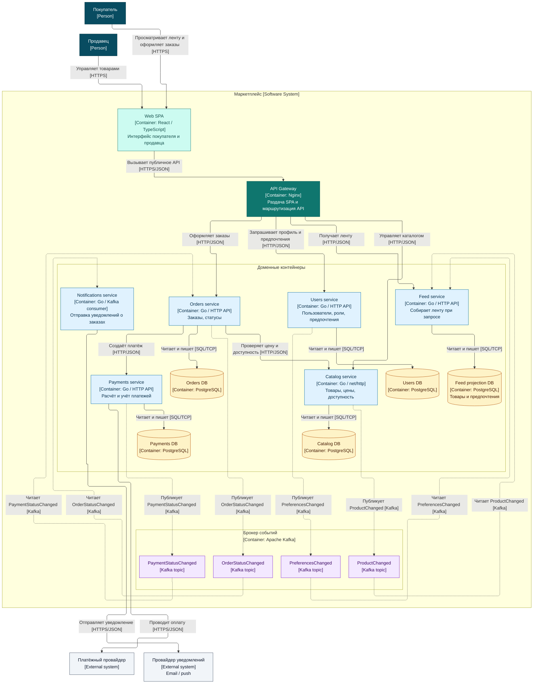

# ДЗ-1: архитектура маркетплейса

Проект содержит C4 Container диаграмму целевой архитектуры и минимально запускаемый `catalog-service`.
В C4 контейнер означает приложение или хранилище, а не обязательно Docker-контейнер. Бизнес-логика, клиентское
приложение, остальные сервисы, базы данных и брокер сообщений пока не реализованы.

## C4 Container диаграмма

Текстовый исходник: [`docs/c4-container.mmd`](docs/c4-container.mmd). Готовый рендер: [`docs/diagram.png`](docs/diagram.png).



## Клиенты и технологии

Покупатель и продавец работают через одно веб-приложение на React и TypeScript. Отдельное мобильное приложение для
первой версии не требуется. Nginx отдаёт статические файлы SPA и маршрутизирует запросы к HTTP API; клиент обращается к
нему по HTTPS, а сервисы внутри системы обмениваются HTTP/JSON.

Для доменных сервисов выбран Go. `Catalog` уже запускается на стандартной библиотеке `net/http`; технологии остальных
сервисов на диаграмме — проектное решение, а не готовая реализация. Users, Catalog, Feed, Orders и Payments владеют
отдельными базами PostgreSQL. Notifications не хранит постоянных данных. Apache Kafka передаёт изменения между
сервисами без синхронного ожидания получателей.

## Домены и сервисы

| Домен / сервис | Ответственность                                    | Данные, которыми владеет сервис                                 |
|----------------|----------------------------------------------------|-----------------------------------------------------------------|
| Users          | Регистрация и управление покупателями и продавцами | учётные записи, роли, предпочтительные категории                |
| Catalog        | Управление продавцом товарами                      | товары, цены, доступность                                       |
| Feed           | Персональная выдача товаров покупателю             | проекции товаров и предпочтений, но не готовые ленты            |
| Orders         | Оформление и сопровождение заказа                  | заказы, позиции, снимки цен, статусы заказов                    |
| Payments       | Расчёт и учёт оплаты                               | сумма к оплате, попытки платежа, записи учёта, статусы платежей |
| Notifications  | Доставка сообщений о состоянии заказа              | постоянных данных нет                                           |

Каждый сервис с базой читает и изменяет только свою базу; общих баз и прямого доступа к данным другого сервиса нет.
Notifications получает события из Kafka и отправляет сообщения через внешнего провайдера.

`Feed` обновляет собственную проекцию по событиям `ProductChanged` и `PreferencesChanged`, а первичные данные остаются у
`Catalog` и `Users`. Готовая лента для каждого покупателя не хранится: при запросе сервис выдаёт доступные товары из
предпочитаемых категорий перед остальными, внутри группы сортируя по новизне. Для такой первой версии достаточно
PostgreSQL. Redis можно добавить как кэш результатов при подтверждённой нагрузке; отдельного кэша на схеме пока нет.

`Catalog` хранит товары, цены и доступность в PostgreSQL. Для отличающихся по категориям атрибутов подойдёт `jsonb`;
переход на документную БД сам по себе не обещает ускорения. Если понадобится сложный полнотекстовый поиск и фильтры,
можно добавить производный поисковый индекс, обновляемый из `ProductChanged`.

## Взаимодействия

Web SPA обращается по HTTPS/JSON к Nginx, который направляет запрос нужному сервису. Для оформления заказа `Orders`
синхронно по HTTP/JSON запрашивает в `Catalog` актуальные цену и доступность, затем вызывает `Payments` для начала
платежа. `Payments` обращается к внешнему платёжному провайдеру (PSP) по HTTPS/JSON. `Notifications` по HTTPS/JSON
отправляет сообщение внешнему провайдеру уведомлений.

Через Kafka сервисы взаимодействуют асинхронно. На диаграмме внутри Kafka показаны топики, а не дополнительные
сервисы; стрелки отражают публикацию и получение каждого события:

| Событие                | Отправитель → получатель | Назначение                          |
|------------------------|--------------------------|-------------------------------------|
| `ProductChanged`       | Catalog → Feed           | Обновить проекцию товара в ленте    |
| `PreferencesChanged`   | Users → Feed             | Обновить проекцию предпочтений      |
| `PaymentStatusChanged` | Payments → Orders        | Изменить статус заказа после оплаты |
| `OrderStatusChanged`   | Orders → Notifications   | Отправить покупателю уведомление    |

Синхронные вызовы нужны там, где заказ нельзя продолжить без текущих цены, наличия или создания платежа. События
подходят для распространения изменений и уведомлений: получателям не требуется отвечать в рамках исходного запроса.
`Notifications` подтверждает обработку события после успешного вызова провайдера. При сбое между вызовом и
подтверждением событие может прийти повторно. Если появятся требования к защите от дублей или истории доставки,
потребуются идемпотентность провайдера или учёт попыток с ограниченным сроком хранения; Redis с TTL сам по себе не
устраняет риск повторной отправки при таком сбое.

При дальнейшей реализации стоит рассмотреть gRPC для внутренних синхронных вызовов `Orders → Catalog` и
`Orders → Payments`: `.proto`-контракты позволят генерировать типизированных клиентов. Решение можно принять после
появления реальных API и требований к задержке или нагрузке; границы сервисов и асинхронные события от выбора
транспорта не зависят.

## Варианты декомпозиции

### Вариант 1: модульный монолит

Все домены находятся в одном приложении с одной базой данных, но разделены на модули.

Плюсы: один деплой, простые транзакции между заказом и платежом, меньше инфраструктуры. Минусы: общая схема данных
размывает владение, выпуск и масштабирование ленты связаны с каталогом и заказами, изменение одного модуля может
затронуть всё приложение.

### Вариант 2: доменные сервисы с отдельными базами

Users, Catalog, Feed, Orders, Payments и Notifications — отдельные сервисы, которые обмениваются HTTP-вызовами и
событиями.

Плюсы: явное владение данными, независимое масштабирование ленты и каталога, изоляция изменений. Минусы: нужны брокер,
мониторинг и обслуживание пяти баз; проекции обновляются не мгновенно, а часть операций проходит через несколько
сервисов.

### Выбранный вариант

Выбран вариант 2: ленту можно масштабировать независимо от оформления заказов, а платёжные данные и операции остаются
в отдельном домене `Payments`. Собственные базы делают границы ответственности явными; события позволяют обновлять
ленту и отправлять уведомления без ожидания в запросе пользователя. Цена выбора — усложнение эксплуатации и задержка
между изменением данных и обновлением их проекций.

## Что реализовано сейчас

Работает только `catalog-service`: `GET /health` на порту `8080` возвращает `200 OK` и тело `ok\n`. У него нет
бизнес-эндпоинтов, логирования, базы данных и интеграций. Остальные элементы на диаграмме — целевая архитектура, а не
поднятые контейнеры.

## Запуск в Docker

Для стандартного запуска нужны Docker CLI и Colima. Из корня репозитория:

```bash
make up
```

Проверка и остановка:

```bash
curl -i http://localhost:8080/health
make down
```

Проверьте статус и тело ответа (`curl -i` также выведет служебные заголовки):

```text
HTTP/1.1 200 OK
...

ok
```

По умолчанию `make up` использует Docker context `colima-distsys`. Если профиль Colima `distsys` ещё не запущен,
команда спросит подтверждение перед его созданием или запуском. Для другого Docker context укажите его явно, например
`make DOCKER_CONTEXT=desktop-linux up` (и аналогично для `down`).

Если установлен `direnv`, после клонирования выполните `direnv allow`: `.envrc` направит обычные команды `docker` в
`colima-distsys`. Вход в каталог сам по себе не запускает виртуальную машину.
