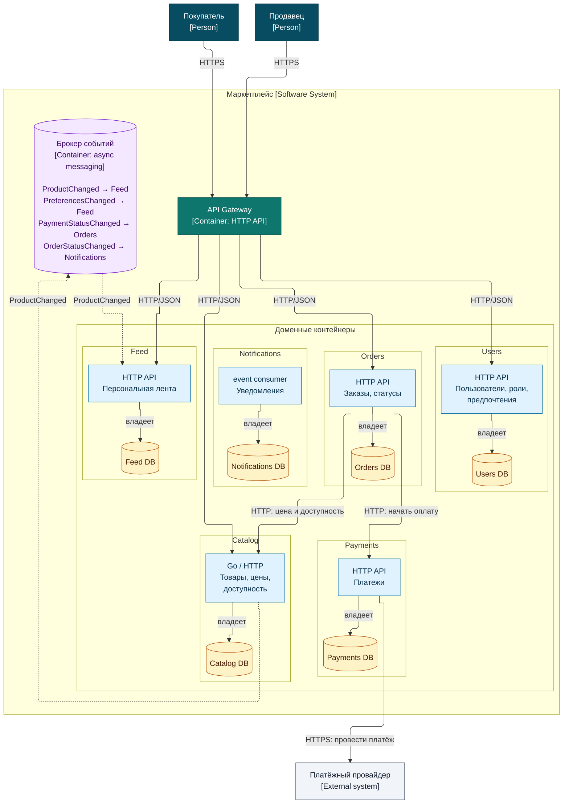

# ДЗ-1: архитектура маркетплейса

Проект содержит C4 Container диаграмму и минимально запускаемый `catalog-service`.
Бизнес-логика, базы данных и брокер сообщений пока не реализованы и показаны как целевая архитектура.

## C4 Container диаграмма

Текстовый исходник: [`docs/c4-container.mmd`](docs/c4-container.mmd).



## Домены и сервисы

| Домен / сервис | Ответственность                                    | Данные, которыми владеет сервис                                 |
|----------------|----------------------------------------------------|-----------------------------------------------------------------|
| Users          | Регистрация и управление покупателями и продавцами | учётные записи, роли, предпочтительные категории                |
| Catalog        | Управление продавцом товарами                      | товары, цены, доступность                                       |
| Feed           | Персональная выдача товаров покупателю             | проекции товаров и предпочтений для ленты                       |
| Orders         | Оформление и сопровождение заказа                  | заказы, позиции, снимки цен, статусы заказов                    |
| Payments       | Расчёт и учёт оплаты                               | сумма к оплате, попытки платежа, записи учёта, статусы платежей |
| Notifications  | Доставка сообщений о состоянии заказа              | сообщения, каналы и статусы доставки                            |

У каждого сервиса своя база данных. Он читает и изменяет только её; общих баз и прямого доступа к данным другого сервиса
нет.

`Feed` строит ленту из событий `ProductChanged` и `PreferencesChanged`. Сначала он выдаёт доступные товары из
предпочитаемых пользователем категорий, затем остальные; внутри группы сортирует по новизне. Это сознательно простое
определение персонализации для первой версии.

## Взаимодействия

Клиенты обращаются по HTTP к API Gateway, который направляет запрос нужному сервису. Для оформления заказа `Orders`
синхронно по HTTP запрашивает в `Catalog` актуальные цену и доступность, затем вызывает `Payments` для начала платежа.
`Payments` обращается к внешнему платёжному провайдеру (PSP).

Через брокер событий сервисы взаимодействуют асинхронно:

| Событие                | Отправитель → получатель | Назначение                          |
|------------------------|--------------------------|-------------------------------------|
| `ProductChanged`       | Catalog → Feed           | Обновить проекцию товара в ленте    |
| `PreferencesChanged`   | Users → Feed             | Обновить проекцию предпочтений      |
| `PaymentStatusChanged` | Payments → Orders        | Изменить статус заказа после оплаты |
| `OrderStatusChanged`   | Orders → Notifications   | Отправить покупателю уведомление    |

Синхронные вызовы нужны там, где заказ нельзя продолжить без текущих цены, наличия или создания платежа. События
подходят для распространения изменений и уведомлений: получателям не требуется отвечать в рамках исходного запроса.

При дальнейшей реализации стоит рассмотреть gRPC для внутренних синхронных вызовов `Orders → Catalog` и
`Orders → Payments`: `.proto`-контракты позволят генерировать типизированных клиентов. Решение можно принять после
появления реальных API и требований к задержке или нагрузке; границы сервисов и асинхронные события от выбора
транспорта не зависят.

## Варианты декомпозиции

### Вариант 1: модульный монолит

Все домены находятся в одном приложении с одной базой данных, но разделены на модули.

Плюсы: один деплой, простые транзакции между заказом и платежом, меньше инфраструктуры. Минусы: общая схема данных
размывает владение, выпуск и масштабирование ленты связаны с каталогом и заказами, изменение одного модуля может
затронуть всё приложение.

### Вариант 2: доменные сервисы с отдельными базами

Users, Catalog, Feed, Orders, Payments и Notifications — отдельные сервисы, которые обмениваются HTTP-вызовами и
событиями.

Плюсы: явное владение данными, независимое масштабирование ленты и каталога, изоляция изменений. Минусы: нужны брокер,
мониторинг и обработка eventual consistency; часть операций проходит через несколько сервисов.

### Выбранный вариант

Выбран вариант 2. В задании явно проверяются границы владения данными, отсутствие общих баз и способы взаимодействия
сервисов. Отдельный `Feed` также можно масштабировать под чтение персонализированной ленты независимо от оформления
заказов. Цена выбора — усложнение эксплуатации и асинхронная доставка части изменений.

## Что реализовано сейчас

Работает только `catalog-service`: `GET /health` на порту `8080` возвращает `200 OK` и тело `ok\n`. У него нет
бизнес-эндпоинтов, логирования, базы данных и интеграций. Остальные элементы на диаграмме — целевая архитектура, а не
поднятые контейнеры.

## Запуск в Docker

Для стандартного запуска нужны Docker CLI и Colima. Из корня репозитория:

```bash
make up
```

Проверка и остановка:

```bash
curl -i http://localhost:8080/health
make down
```

Проверьте статус и тело ответа (`curl -i` также выведет служебные заголовки):

```text
HTTP/1.1 200 OK
...

ok
```

По умолчанию `make up` использует Docker context `colima-distsys`. Если профиль Colima `distsys` ещё не запущен,
команда спросит подтверждение перед его созданием или запуском. Для другого Docker context укажите его явно, например
`make DOCKER_CONTEXT=desktop-linux up` (и аналогично для `down`).

Если установлен `direnv`, после клонирования выполните `direnv allow`: `.envrc` направит обычные команды `docker` в
`colima-distsys`. Вход в каталог сам по себе не запускает виртуальную машину.
